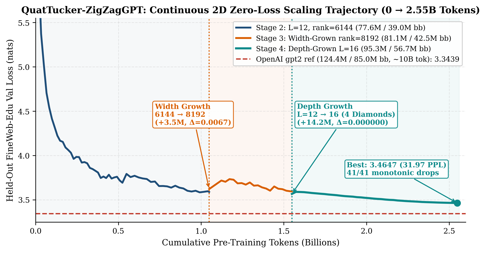

# QuatTucker-ZigZagGPT (v3.0)

**Quaternion-Tucker ZigZag Networks: Halving Transformer Backbone Parameters and Enabling Exact 2D Zero-Loss Continual Scaling**

[](https://doi.org/10.5281/zenodo.24424501)
[](https://huggingface.co/spacetime9)

**Author:** Shubham Barmase *(Independent Researcher)*

<p align="center">
  
</p>

---

## Key Highlights (v3.0 — 6.00B Tokens, Depth-20)

1. **Matches `GPT-3 Small` (`125M`, `300B` tokens) Across All `16,955` Full-Split Questions (`44.75%` vs `44.75%`) at `50×` Fewer Tokens (`6.00B`)** and a **`16.6%` smaller backbone** (`70.9M` vs `85.0M`), beating `GPT-3 Small` on **`WinoGrande` (`52.09%` vs `52.00%`)** and **`BoolQ` (`56.73%` vs `49.70%`, `+7.03%`)**.
2. **Exact 2D Zero-Loss Continual Scaling (Width + Two Consecutive Depth Expansions):** One continuous checkpoint lineage scaled live from **`77.6M → 81.1M → 95.3M → 109.5M`** across **`6.00B` tokens**:
   - **Width / Rank Growth (Stage 3):** `rank 6144 → 8192` (`+3.5M` params — **`10.8×` cheaper** than dense FFN expansion, `max_diff = 0.0067`).
   - **Depth Growth #1 (Stage 4):** `L = 12 → 16` layers (3 → 4 Braided ZigZag Diamonds, **`max_diff = 0.000000`**), `41/41` monotonic drops to `3.4647` (`31.97` PPL).
   - **Code Integration (Stage 5):** `+15% Python-Edu` (`3.55B` tok) → `3.4327` (`30.96` PPL).
   - **Depth Growth #2 (Stage 6):** `L = 16 → 20` layers (4 → 5 Diamonds, `70.9M` bb, **`max_diff = 0.000000`**), `+1.5B` tok → `3.4050` (`30.12` PPL).
   - **WSD High-Quality Cooldown (Stage 7):** `+1.0B` tok (`70% FW-Edu + 15% Cosmo + 10% Math + 5% Python`) → **`3.3582` (`28.74` PPL)** — within `0.41` PPL of OpenAI `gpt2` (`28.33` PPL).
3. **Controlled Head-to-Head Wins:**
   - **A100 GPT-2 Scale (`16.4M` tok):** `QuatTucker-ZigZagGPT-12` (`77.6M` / `39.0M` bb) wins **5/5 checkpoints** against `StandardGPT-12` (`123.6M` / `85.0M` bb) with `46.0M` fewer parameters.
   - **L4 8-Layer (`FineWeb-Edu`):** `QuatTucker-ZigZagGPT-8` (`7.2M` bb) beats `StandardGPT-8` (`14.3M` bb) by **`-17.30` PPL** (`169.68` vs `186.98`) with half the backbone.
4. **56-Seed Pure Routing Topology Ablation:** Isolating routing alone at identical parameters proves `Sequential < Braided ZigZag (0→2→1→3) < Braided + 1 Loop (L3→L1)`, lifting unseen 8-bit Parity by `+8.6%` (`75.1% → 83.7%`) and 3D Cuboid 4-Corner Parity by `+13.8%` (`74.7% → 88.5%`).

---

## Full-Split Zero-Shot Downstream Benchmarks (`20,465` Questions)

Evaluated with length-normalized log-likelihood scoring on the **complete** test/validation splits (zero `$N=500$` sampling noise):

| Benchmark (Full Split $N$) | Stage 5 (`3.55B`, L=16) | Stage 6 (`5.00B`, L=20) | **Stage 7 (`6.00B`, L=20)** | `GPT-3 Small`* (`125M`, `300B`) |
|---|---:|---:|---:|---:|
| **ARC-Easy** (`2,376`) | 40.74% | 42.09% | 42.17% | **43.60%** |
| **HellaSwag** (`10,042`) | 27.55% | 27.97% | 28.01% | **33.70%** |
| **WinoGrande** (`1,267`) | 50.43% | 51.14% | **52.09%** | 52.00% |
| **BoolQ** (`3,270`) | **59.51%** | 55.44% | 56.73% | 49.70% |
| **Core 4-Task Avg (`16,955`)** | 44.56% | 44.16% | **44.75%** | **44.75%** |
| **PIQA** (`1,838`) | — | — | 61.43% | **64.60%** |
| **ARC-Challenge** (`1,172`) | — | — | 24.74% | **26.60%** |
| **OpenBookQA** (`500`) | — | — | 27.60% | **35.60%** |

*\*`GPT-3 Small` (`125M`, `300B` tokens) is the published Brown et al. (2020) full-split reference. On the exact same `$N=500$` harness against OpenAI `gpt2` (`42.50%`), `QuatTucker-16` scored `44.65%` at `2.55B` and `46.70%` at `3.55B`.*

---

## Single-Lineage 2D Continual Scaling (NVIDIA A100-40GB)

| Stage / Checkpoint | Layers / Rank | Total | Backbone | Growth `max_diff` | Cum. Tokens | Held-Out `FineWeb-Edu` Val | PPL |
|---|---|---:|---:|---:|---:|---:|---:|
| Stage 2 (`best_1B.pt`) | `L=12, R=6144` | 77.6M | 39.0M | — | 1.05B | 3.5849 | 36.05 |
| Stage 3 (`best_1.5B_grown.pt`) | `L=12, R=8192` | 81.1M | 42.5M | `0.0067` | 1.55B | 3.5963 | 36.46 |
| Stage 4 (`best_2.5B_depth16.pt`) | `L=16, R=8192` | 95.3M | 56.7M | `0.000000` | 2.55B | 3.4647 | 31.97 |
| Stage 5 (`best_3.5B_depth16.pt`, +Py) | `L=16, R=8192` | 95.3M | 56.7M | — | 3.55B | 3.4327 | 30.96 |
| Stage 6 (`best_5B_depth20.pt`) | `L=20, R=8192` | 109.5M | 70.9M | `0.000000` | 5.00B | 3.4050 | 30.12 |
| **Stage 7 (`best_6B_depth20.pt`, WSD)** | **`L=20, R=8192`** | **109.5M** | **70.9M** | **—** | **6.00B** | **3.3582** | **28.74** |
| *Ref: OpenAI `gpt2`* | *`L=12`, dense* | *124.4M* | *85.0M* | *—* | *~10.0B* | *3.3439* | *28.33* |

### Post-Training (SFT & Sequence Distillation)

| Run | Base Checkpoint | Dataset | Start Val | Final Val |
|---|---|---|---:|---:|
| `Qwen3.5-0.8B` 10k Distill | `best_1.5B_grown.pt` (`L=12`) | `9,487` tr / `500` val | 2.4558 | **1.6650** |
| **`SmolTalk` 100k SFT (Stage 4)** | **`best_2.5B_depth16.pt` (`L=16`)** | **`99,000` tr / `1,000` val** | **2.0456** | **1.4975** |
| `SmolTalk` 100k SFT (Stage 5, asst-only) | `best_3.5B_depth16.pt` (`L=16`) | `99,000` tr / `1,000` val | 2.1820 | **1.6123** |

---

## Repository Contents

- [`main.pdf`](main.pdf) — Full 12-page Paper v3.0 (12 figures, 6 tables, 35 references)
- [`main.tex`](main.tex) & [`references.bib`](references.bib) — LaTeX source
- [`quattucker_zigzag_v2.py`](quattucker_zigzag_v2.py) — Standalone PyTorch implementation (RoPE + RMSNorm + FlashAttn + 4D QuatTucker ZigZag + exact `grow_depth()` zero-loss expansion)
- [`quattucker_zigzag.py`](quattucker_zigzag.py) — Original 8-layer L4 implementation
- [`generate_v2_figures.py`](generate_v2_figures.py) — Reproducible figure generator
- [`data/experiments.json`](data/experiments.json) & [`data/gpt2_scale_a100.json`](data/gpt2_scale_a100.json) — Complete raw experimental logs

## Citation

```bibtex
@misc{barmase2026quattucker,
  title={Quaternion-Tucker ZigZag Networks: Halving Transformer Backbone Parameters and Enabling Exact 2D Zero-Loss Continual Scaling},
  author={Barmase, Shubham},
  year={2026},
  doi={10.5281/zenodo.24477893},
  url={https://doi.org/10.5281/zenodo.24424501}
}
```
