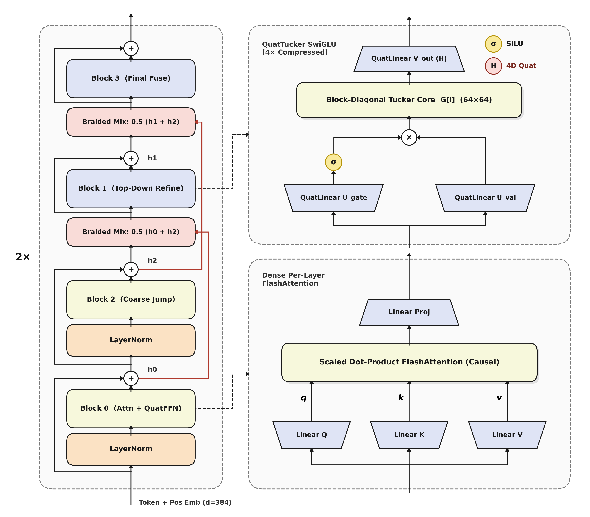
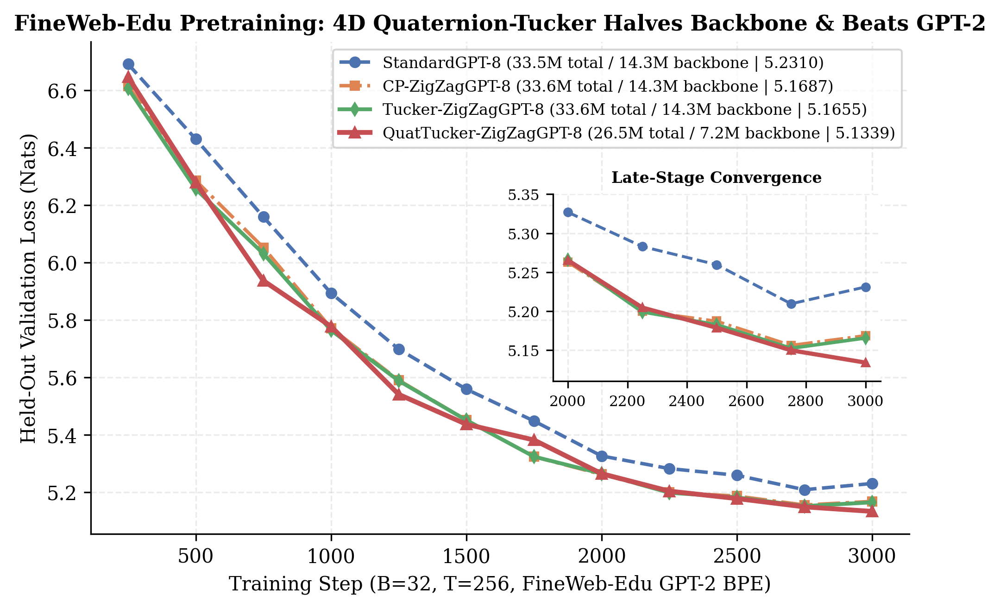

# Quaternion-Tucker ZigZag Networks (`QuatTucker-ZigZagGPT`)

[](https://doi.org/10.5281/zenodo.24424502)

Official implementation, consolidated experimental data, and LaTeX source for:

> **Quaternion-Tucker ZigZag Networks: Halving Transformer Backbone Parameters via Shared Hypercomplex Tensor Cores and Braided Top-Down Routing**
> *Shubham Barmase (Independent Researcher), November 2026*
> Preprint: [https://zenodo.org/records/24424502](https://zenodo.org/records/24424502)

---

## Architecture Overview

`QuatTucker-ZigZagGPT` unifies three orthogonal mechanisms:
1. **4D Quaternion Hamilton Algebra ($\mathbb{H}$):** Replaces dense scalar FFN projections with `QuatLinear` compiled into a single fused `bfloat16` Tensor-Core GEMM ($4\times$ FFN compression).
2. **Block-Diagonal Tucker SwiGLU Cores:** Shares a single high-rank SwiGLU basis across 4 depths while specializing each depth via a $64 \times 64$ real-valued Tucker core $G[l]$.
3. **Braided `ZigZag` Diamond Routing (`0 → 2 → 1 → 3`):** Zero-FLOP, zero-parameter top-down refinement expanding a single sequential Jacobian path into 3 concurrent gradient pathways.



---

## Key Results (`FineWeb-Edu`, GPT-2 BPE, NVIDIA L4, 3,000 Steps)

| Model | Total Params | Backbone Params | Final Val Loss | Final PPL |
| :--- | :---: | :---: | :---: | :---: |
| `StandardGPT-8` (FlashAttn) | `33.5M` | `14.3M` | `5.2310` | `186.98` |
| `CP-ZigZagGPT-8` | `33.6M` | `14.3M` | `5.1687` | `175.68` |
| `Tucker-ZigZagGPT-8` | `33.6M` | `14.3M` | `5.1655` | `175.13` |
| **`QuatTucker-ZigZagGPT-8`** | **`26.5M`** | **`7.2M` (`2.0x` smaller)** | **`5.1339`** | **`169.68`** |



---

## Quickstart

```python
import torch
from quattucker_zigzag import QuatTuckerZigZagGPT

model = QuatTuckerZigZagGPT(vocab_size=50257, max_seq_len=256, d_model=384, n_heads=6, rank=4096)
idx = torch.randint(0, 50257, (2, 128))
logits = model(idx)  # [2, 128, 50257]
```

## Repository Structure

- `quattucker_zigzag.py` — Standalone PyTorch implementation (`QuatLinear`, `QuatTuckerZigZagDiamond`, `QuatTuckerZigZagGPT`)
- `data/experiments.json` — Complete verified raw numbers across all benchmarks
- `scripts/` — Reproducible 300-DPI PNG + vector PDF figure generators
- `main.tex`, `references.bib`, `main.pdf` — Full LaTeX paper & compiled PDF

## Citation

```bibtex
@misc{barmase2026quattucker,
  title={Quaternion-Tucker ZigZag Networks: Halving Transformer Backbone Parameters via Shared Hypercomplex Tensor Cores and Braided Top-Down Routing},
  author={Barmase, Shubham},
  year={2026},
  publisher={Zenodo},
  doi={10.5281/zenodo.24424502},
  url={https://doi.org/10.5281/zenodo.24424502}
}
```
